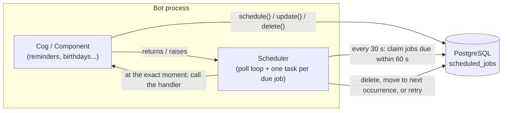
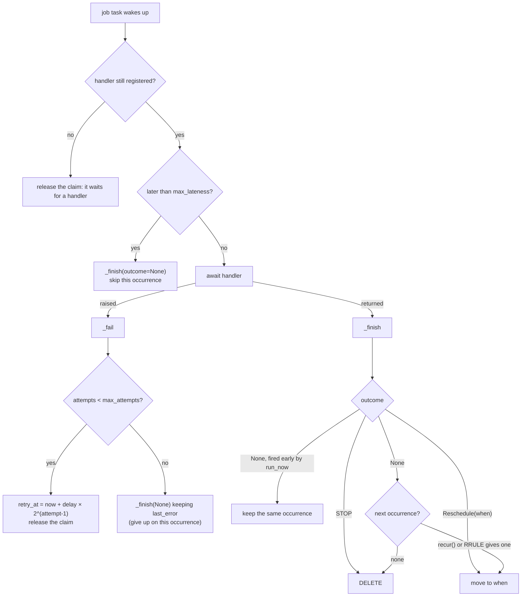

# ⏰ How the scheduler works

This is the long explanation of `shared.scheduler` (and `shared.timeparse`, its companion for times that users type).
It starts with the big picture, then goes file by file, then explains the async and database concepts the code
relies on, and ends with how the bots use it and what its limits are.

You don't need to read the code alongside, but every section names the functions it talks about,
so you can jump there.

## 🗺️ The big picture

The scheduler runs **jobs** at their time: "remind Irene in 2 hours", "congratulate this person at midnight on their
birthday", "post a periodic message in a few weeks". Jobs live in a PostgreSQL table, `scheduled_jobs`, so they
survive restarts, deploys and crashes.

Each bot has its own `Scheduler` object and its own table (in its own schema: `alubot.scheduled_jobs`,
`irenesbot.scheduled_jobs`). A feature (a cog or a component) does two things:

1. **Schedules jobs**: `await bot.scheduler.schedule("reminder", when, data={...}, user_id=...)` inserts a row.
2. **Handles them**: a method decorated with `@scheduler.handler("reminder")` is called when a job of that kind is due.



Three ideas carry the whole design:

1. **Times are stored as clock time + timezone**, not as UTC. "10:00 in Berlin" stays 10:00 in Berlin even if Germany
   changes its DST rules after the reminder was set. See **🕰️ Wall time**.
2. **Poll, then sleep precisely.** Every 30 seconds the scheduler asks the database for the jobs due in the next minute,
   then gives each one its own task that sleeps until the exact second. See **🔁 The loop**.
3. **Handlers don't manage jobs.** A handler returns normally (done) or raises (retry). Deleting one-off jobs, moving
   repeating jobs forward, retrying with back-off: the scheduler does all of it. See **🎬 Outcomes**.

## 📁 The files

```text
shared/
├── scheduler/
│   ├── __init__.py      re-exports everything below
│   ├── walltime.py      WallTime: a time on the clocks of a timezone; resolve() matches PostgreSQL's DST rules
│   ├── recurrence.py    RRULE repeats evaluated on the wall clock
│   ├── jobs.py          Job (a row), handler outcomes (Reschedule, STOP), HandlerSpec, @handler
│   ├── scheduler.py     Scheduler: the table, the poll loop, firing, retries, the public API
│   └── schema.sql       the table, created on start
├── timeparse.py         "2h30m", "tomorrow 3pm", "eow"... → WallTime; split_time() for chat
└── tests/
    ├── test_scheduler_time.py   pure tests: DST, rules, registration
    ├── test_scheduler_db.py     against a real PostgreSQL (throwaway schemas)
    └── test_timeparse.py        parsing and splitting
```

The dependency direction is simple: `walltime` ← `recurrence` ← `jobs` ← `scheduler`, and `timeparse` uses `walltime`.
Nothing in `shared.scheduler` imports Discord or Twitch: the bots plug it in.

## 🗃️ The table (`schema.sql`)

```sql
CREATE TABLE IF NOT EXISTS scheduled_jobs (
    id          BIGINT GENERATED ALWAYS AS IDENTITY PRIMARY KEY,
    kind        TEXT NOT NULL,          -- which handler runs it, e.g. 'reminder'
    key         TEXT UNIQUE,            -- optional unique name, e.g. 'birthday:123'
    user_id     BIGINT,                 -- who the job belongs to
    guild_id    BIGINT,                 -- which guild (Discord) or channel (Twitch) it belongs to
    local_due   TIMESTAMP NOT NULL,     -- wall clock time of the next occurrence in `timezone`
    timezone    TEXT NOT NULL DEFAULT 'UTC',
    rule        TEXT,                   -- RFC 5545 RRULE for repeating jobs
    data        JSONB NOT NULL DEFAULT '{}',
    created_at  TIMESTAMPTZ NOT NULL DEFAULT NOW(),
    claimed_at  TIMESTAMPTZ,            -- set while a scheduler holds the job to run it
    retry_at    TIMESTAMPTZ,            -- overrides the due moment: retries and "run now"
    attempts    INTEGER NOT NULL DEFAULT 0,
    last_error  TEXT
);
```

Things worth noticing:

* **`local_due` is `TIMESTAMP` (without time zone)** on purpose. It's what the clocks show, paired with `timezone`.
  The actual moment is computed when needed: `local_due AT TIME ZONE timezone`. Two SQL expressions appear everywhere
  in `scheduler.py`:

  ```python
  COLUMNS = "*, (local_due AT TIME ZONE timezone) AS due_at"
  FIRE_AT = "COALESCE(retry_at, local_due AT TIME ZONE timezone)"
  ```

  `due_at` is "when this occurrence is due". `FIRE_AT` is "when it actually fires": the same, unless a retry or
  `run_now` set `retry_at`.
* **There's no index on the due moment.** An expression index on `local_due AT TIME ZONE timezone` is technically
  possible, but it would freeze the conversion at insert time, which defeats the point of storing wall time.
  The tables hold dozens or hundreds of rows, so a sequential scan every 30 seconds costs nothing.
* **Names are unqualified** (`scheduled_jobs`, not `alubot.scheduled_jobs`). The table lands in the first schema of the
  connection's `search_path`, so each bot gets its own table with the same code, and moving schemas around
  (a database restructure, Docker) needs no code change.
* **`key` is `UNIQUE` but nullable.** PostgreSQL allows any number of `NULL`s in a unique column, so jobs without a key
  (reminders) don't collide, while keyed jobs (`birthday:123`) can only exist once.
* **The scheduler creates the table itself**: `Scheduler.install()` runs `schema.sql` on `start()`. All statements are
  `IF NOT EXISTS`, so it's safe every time.

## 🕰️ Wall time instead of UTC

### 💥 The problem

The usual advice is "store everything in UTC". That's right for things that already happened, and for absolute future
moments ("in 2 hours"). It's wrong for future events set in local time.

Say someone in Berlin sets a reminder for "1 July 2027, 10:00". Today Berlin is UTC+2 in summer, so UTC storage would
save `08:00 UTC`. Now suppose the EU abolishes DST in 2027 and Berlin stays at UTC+1 all year. The stored `08:00 UTC`
is now 09:00 in Berlin. The reminder fires an hour early, and nothing in the database could tell you.

This isn't hypothetical: Russia changed its rules in 2011 and again in 2014, Egypt cancelled DST with a few days'
notice, and the EU has a pending decision to drop it. The fix (from Jon Skeet's
[*Storing UTC is not a silver bullet*](https://codeblog.jonskeet.uk/2019/03/27/storing-utc-is-not-a-silver-bullet/))
is to store what the user meant, the local time and the zone, and to derive UTC when needed, with the rules in force
at that moment.

### 🧱 `walltime.py`

```python
@dataclass(frozen=True, slots=True)
class WallTime:
    local: dt.datetime  # naive: what the clocks show
    timezone: str = UTC  # IANA key; "UTC" makes it absolute
```

* `WallTime(dt.datetime(2027, 7, 1, 10), "Europe/Berlin")` is a reminder at 10:00 Berlin time, whatever the rules are then.
* `WallTime.from_aware(moment)` (default zone UTC) is an **absolute** time: UTC never has DST, so its clock time and its
  moment are the same thing. "In 2 hours" is stored this way.
* `wall + dt.timedelta(days=1)` shifts the *clock*: the same time tomorrow, even if tomorrow is 23 or 25 hours away.
* `__post_init__` rejects aware datetimes (a `WallTime` with two timezones would be ambiguous) and unknown zones.

The scheduler accepts either kind wherever it takes a time (`type When = dt.datetime | WallTime`).
`to_wall_time(when, timezone)` normalizes: a `WallTime` stays as it is; an aware datetime is read on the clocks of
`timezone` (UTC by default, making it absolute).

### 🌗 DST gaps and overlaps: `resolve()`

Twice a year a wall time is weird:

* **Spring forward:** in Berlin on 29 March 2026 clocks jump from 02:00 to 03:00. 02:30 never happens.
* **Fall back:** on 25 October 2026 clocks go 03:00 → 02:00. 02:30 happens twice.

PostgreSQL and Python handle these differently by default. This was checked on a real database before writing the code:

| Local time | PostgreSQL `AT TIME ZONE` | Python, `fold=0` (default) | Python, `fold=1` |
| --- | --- | --- | --- |
| 2026-03-29 02:30 (skipped) | 01:30 UTC | 01:30 UTC | 00:30 UTC |
| 2026-10-25 02:30 (twice) | **01:30 UTC** (the later one) | **00:30 UTC** (the earlier one) | 01:30 UTC |

The database decides when jobs fire, so Python must show the same moment. `resolve(local, timezone)` mirrors PostgreSQL:

```python
first = local.replace(tzinfo=zone, fold=0)
second = local.replace(tzinfo=zone, fold=1)
if first.utcoffset() == second.utcoffset():  # a normal time
    return first.astimezone(dt.UTC)
is_gap = first.astimezone(dt.UTC).astimezone(zone).replace(tzinfo=None) != local
return (first if is_gap else second).astimezone(dt.UTC)
```

The trick: in a gap, the time doesn't survive a round trip (02:30 → UTC → back gives 03:30), while in an overlap it does.
`test_database_and_python_agree_on_dst_moments` checks both against the real database.

> [!NOTE]
> Python's `zoneinfo` reads the `tzdata` package (a dependency of `shared`, because Windows and slim Docker images
> have no system zone database). PostgreSQL has its own copy. If one is updated long before the other and a country
> changed its rules in between, the time *shown* by the bot could differ from the time the job *fires*.
> The job always fires by PostgreSQL's rules.

## 🔂 Repeating jobs (`recurrence.py`)

A job repeats in one of two ways.

### 📅 RRULEs

`rule` holds an [RFC 5545](https://datatracker.ietf.org/doc/html/rfc5545#section-3.3.10) RRULE string, the format
calendar apps use: `FREQ=DAILY`, `FREQ=WEEKLY;BYDAY=MO,FR`, `FREQ=MONTHLY;UNTIL=20271231T000000`.
`dateutil.rrule` evaluates it, and the key point is that it's evaluated on **naive local times**:

```python
def next_occurrence(rule, *, current, after):
    return _parse(rule, current).after(max(current, after))
```

`current` is the occurrence that just ran (as `DTSTART`) and `after` is "now" on the job's clocks. Because both are
naive, "every day at 09:00" gives 09:00 the next day even across a DST change. The UTC moment is only derived later,
by PostgreSQL.

`max(current, after)` is what **collapses missed occurrences**: if the bot was down for three days, the next run is
the first one after *now*, not three catch-up runs in a row.

`validate_rule` rejects `COUNT=`: the job only knows its next occurrence, not how many ran before, so `COUNT=3` would
restart counting every time. Use `UNTIL=` instead. `min_gap` finds the shortest interval among the first occurrences,
so a bot can refuse rules that fire too often.

### 🎂 Custom `recur`

Some repeats don't fit an RRULE:

* **Birthdays on 29 February.** `FREQ=YEARLY` from 29 Feb silently skips non-leap years. AluBot's `next_birthday`
  puts them on the 28th instead.
* **Random intervals.** The periodic message comes back after a random 5–10 weeks.

For these, the handler declares `recur=some_function`. It's called as `recur(job, now)` and returns the next `When`
(or `None` to stop). It takes precedence over the job's RRULE. See `Scheduler._next_occurrence`.

## 🧩 Jobs, handlers and outcomes (`jobs.py`)

### 📦 `Job`

`Job` is a frozen dataclass built from a row (`Job.from_row`). It's generic over its data:
`Job[ReminderData]` tells the type checker what `job.data["text"]` is. The important computed fields:

* `job.when`: the `WallTime` of the current occurrence.
* `job.due_at`: that occurrence as a UTC moment, as computed by the database.
* `job.fire_at`: `retry_at or due_at`, when it actually fires.
* `job.fired_at` and `job.lateness`: set when the job is passed to a handler; `lateness` is how far past `due_at`
  the handler was called (zero if on time). Reminders use it to say "sorry, I'm late".
* `job.data` is a `frozendict` (Python 3.15): handlers can't mutate it by accident. To change data, call
  `scheduler.update(...)` or schedule a new job with `{**job.data, ...}`.

### 🏷️ `@handler` and `HandlerSpec`

```python
@scheduler.handler("birthday", recur=next_birthday, max_lateness=dt.timedelta(days=1), max_attempts=1)
async def birthday_congratulations(self, job: Job[BirthdayData]) -> scheduler.Stop | None: ...
```

The decorator doesn't wrap anything: it only puts the options on the function as an attribute
(`__scheduler_handler__`). `Scheduler.register_handlers(cog)` later finds the marked methods and turns each into a
`HandlerSpec(kind, func, recur, max_lateness, max_attempts, retry_delay)`.

Why not register at decoration time? At class definition there's no bot and no scheduler yet, and the handler needs to
be a *bound* method (with `self`) of the actual cog instance. Marking first and registering when the cog is added is the
same pattern discord.py uses for listeners.

`_marked_methods` scans `vars(cls)` along the MRO instead of using `inspect.getmembers(obj)`: `getmembers` evaluates
every attribute, properties included, and some cog properties (like `Birthdays.birthday_role`) raise before the bot is
ready.

### ↩️ What a handler can return

| Return | Meaning |
| --- | --- |
| `None` (just return) | Done. One-off jobs are deleted; repeating jobs move to their next occurrence. |
| `Reschedule(when)` | Keep the job and fire it again at `when` (chatter uses it: "nobody is talking, check again in 30 min"). |
| `STOP` | Delete the job even if it repeats (birthdays of people who left for good). |
| *raise* | Failed: retry with back-off, then give up. |

`STOP` is a single-member enum. The typing module's `sentinel` (PEP 661) isn't in Python 3.15, and an enum member is
the standard way to get a unique, typed, picklable sentinel.

## 🔁 The loop: poll, then sleep precisely

`Scheduler._run` is one long-lived task:

```python
while not self._closing:
    self._wake.clear()
    await self._poll()  # claim jobs due within the next minute
    async with asyncio.timeout(poll_interval):
        await self._wake.wait()  # sleep up to 30 s, or until woken
```

### 🤔 Why poll at all?

The classic design (RoboDanny, and AluBot's old scheduler) sleeps until the next job and cancels and restarts that sleep
whenever an earlier job appears. It works, but it has sharp edges: a 40-day look-ahead window (because `asyncio.sleep`
can't reliably sleep ~48+ days on some platforms), restart races, and separate code for "short" in-memory timers.

Polling is boring and robust: every 30 seconds, one query. Precision comes from the second half.

### ✋ Claiming (`_poll`)

```sql
WITH due AS (
    SELECT id FROM scheduled_jobs
    WHERE claimed_at IS NULL AND kind = ANY($3::TEXT[]) AND {FIRE_AT} <= $2   -- $2 = now + 60 s
    FOR UPDATE SKIP LOCKED
)
UPDATE scheduled_jobs AS jobs SET claimed_at = $1                               -- $1 = now
FROM due WHERE jobs.id = due.id
RETURNING jobs.*, (jobs.local_due AT TIME ZONE jobs.timezone) AS due_at;
```

* **Look-ahead** (`lookahead = 2 × poll_interval` = 60 s): every job is claimed 30–60 seconds before it's due,
  so no poll can miss it.
* **Only kinds with a handler** are claimed (`kind = ANY(...)`). A job whose cog isn't loaded (the test bot in subset
  mode, a typo) just waits in the table. `_warn_about_unknown_kinds` logs once an hour if such jobs are more than an
  hour overdue.
* **Claiming and reading are one statement**, so there's no window where two pollers could both read the same row.
  `FOR UPDATE SKIP LOCKED` makes a second, concurrent poller skip rows the first one is busy with.
  See **🐘 Database concepts**.

### 😴 One task per job (`_spawn`, `_fire`, `_sleep_until`)

Each claimed job gets its own task that sleeps until `job.fire_at`, then runs:

```python
async def _sleep_until(self, moment):
    while (seconds := (moment - self.clock()).total_seconds()) > 0:
        await asyncio.sleep(min(seconds, self.poll_interval.total_seconds()))
```

Why the loop instead of one `asyncio.sleep(seconds)`? `asyncio.sleep` measures **monotonic** time, the job is due by the
**wall** clock, and the two drift apart (NTP corrections, a suspended laptop). Sleeping in steps of at most 30 seconds
and re-checking the wall clock keeps the error small. This is also the bug found in Salamander's scheduler during the
research: it fired jobs up to a minute early because it computed the delay backwards and never re-checked.

```mermaid
sequenceDiagram
    participant Cog
    participant DB as scheduled_jobs
    participant Loop as Scheduler._run
    participant Task as job task

    Cog->>DB: schedule("reminder", in 45 s)
    Cog->>Loop: _wake.set() (due within 60 s)
    Loop->>DB: claim jobs due before now + 60 s
    DB-->>Loop: the reminder (claimed_at = now)
    Loop->>Task: create_task(_fire(job))
    Note over Task: sleeps until fire_at,<br/>re-checking the wall clock
    Task->>Cog: handler(job)
    Cog-->>Task: returns None
    Task->>DB: DELETE ... WHERE id = $1 AND claimed_at = $2
```

### ⏩ Waking up early

New jobs shouldn't wait up to 30 seconds for the next poll if they're due in 10. Every write that creates or moves a job
calls `_wake_if_soon(moment)`, which sets the `asyncio.Event` if the moment is within the look-ahead. `_run` is waiting on
that event (with a 30 s timeout), so it polls right away.

Note the order in `_run`: `self._wake.clear()` happens **before** `_poll()`, not after. If a job were scheduled while
`_poll` is awaiting the database and the event were cleared afterwards, that wake-up would be lost until the next timeout.
Clearing first means any `set()` during the poll survives and causes one more immediate poll.

### 📣 Waking up for changes made elsewhere: `LISTEN/NOTIFY`

`_wake_if_soon` only covers changes this process makes. When LalaBot's ▶️ Retry now button (or you, in `psql`) changes a
job, the bot would only notice on its next poll. PostgreSQL has a built-in message bus for this: a connection can
`LISTEN` on a named channel, and `NOTIFY` (or `pg_notify(...)`) on that channel reaches every listener when the
transaction commits. It's part of PostgreSQL itself, not a service to run.

* `schema.sql` adds a trigger on `scheduled_jobs` that calls `pg_notify('scheduled_jobs', <schema>)` for every row that is
  inserted or updated **and left unclaimed** (`WHEN (NEW.claimed_at IS NULL)`). Claims set `claimed_at`, so the
  scheduler's own claiming doesn't wake itself in a loop. Every bot notifies the same channel with its schema as the
  payload, and `_on_notify` ignores the other bots'.
* `_ensure_listener` holds one pool connection with `add_listener` on it. It runs *after* each poll, so a slow or failing
  connection never delays jobs: without the listener everything still works, just on the next 30-second poll.
  A dropped connection (a database restart) is noticed (`is_closed()`) and replaced on the next round.

### 🚦 At most 5 handlers at a time

After downtime many jobs are due at once. Each still gets its task, but `_execute` runs the handler inside
`async with self._slots:`, an `asyncio.Semaphore(max_concurrency)` (5 by default). The others wait for a free slot,
so a backlog drains at a steady pace instead of every handler hitting Discord's rate limits at the same second.
`fired_at` (and so `lateness`) is taken once the slot is acquired.

### ⏸️ Pausing

`pause(job_id)` sets `paused_at`; claiming skips paused jobs. `resume(job_id)` clears it, and if the job's occurrence passed
in the meantime, a repeating job moves on to its next occurrence after now (the missed ones are skipped, as after
downtime), while a one-off job fires right away.

## 🎬 What happens after a handler runs

`_execute` is the heart of firing:



Details worth knowing:

* **Retries keep the occurrence.** A retry sets `retry_at`, not `local_due`. When the retry finally succeeds,
  `_next_occurrence` computes the next date from the *original* occurrence (`job.when`), not from the retry time.
  For the same reason, lateness is always measured from `due_at`.
* **Back-off doubles:** with `retry_delay=1 min`, retries come after 1, 2, 4... minutes.
* **Giving up isn't deleting a repeating job.** A birthday that fails is given up for this year and moves to next year,
  keeping the traceback in `last_error` so you can look at it with SQL.
* **`run_now` doesn't consume the occurrence.** If a daily job due tomorrow is fired today with `run_now`, it still fires
  tomorrow. `_finish` detects this with `job.due_at > now`.
* **Every finishing write is guarded:** `WHERE id = $1 AND claimed_at = $2`. If the job was changed or deleted while the
  handler ran, the claim no longer matches and the write does nothing. See
  **compare-and-set**.

## 📜 History (`scheduled_job_runs`)

Every handler run, and every occurrence skipped for being too late, adds a row to `scheduled_job_runs`: the job's ID,
kind, key, user and guild, when it was due, when it fired and finished, which attempt it was, the outcome (`done`,
`rescheduled`, `stopped`, `skipped`, `failed` (retried later) or `gave_up`) and the traceback for failures. The job's own
row is usually deleted after it runs, so this is the only way to answer "did my reminder go out?" or "what failed
this week?". Rows older than 90 days are deleted with the hourly unknown-kinds check. `Scheduler.history(...)` reads it.
Writing a history row can't fail a job: errors are reported and the job carries on.

## 🧠 Async concepts used here

All of this runs on one asyncio event loop: one thread, many tasks taking turns at each `await`.

### ⚛️ Code between two `await`s is atomic

A task only yields control at an `await`. So this, in `_fire`, can't be interrupted:

```python
self._pending.pop(job.id, None)
self._running[job.id] = task
```

There's no `await` between the two lines, so no other task can ever see the job in neither dict or in both. `_forget`
(called by `delete()` and `update()`) only cancels tasks in `_pending`, i.e. still sleeping, so a handler that has
started is never cancelled halfway through by an edit. This is the asyncio equivalent of a lock, and it's free.

### 🔗 Tasks need strong references

`asyncio.create_task()` returns a task, but the event loop only keeps a *weak* reference to it. A task nobody holds can be
garbage-collected mid-flight, silently. Every task the scheduler creates is held somewhere:

* job tasks in `_pending` and `_running`;
* the loop in `_loop_task`;
* fire-and-forget work (releasing claims after `unregister`) in `_background_tasks`, a set that each task removes itself
  from with `add_done_callback(self._background_tasks.discard)`.

### 🛑 Cancellation is an exception you mostly shouldn't catch

`task.cancel()` makes the task's current `await` raise `asyncio.CancelledError`. Since Python 3.8 it inherits from
`BaseException`, not `Exception`, so the scheduler's many `except Exception:` blocks (which keep the loop alive through
any error) don't swallow cancellation. `try/finally` still runs, which is how `_fire` always removes the job from
`_running`.

### 🚩 Events and timeouts

`asyncio.Event` is a flag tasks can wait on: `set()` wakes every waiter, `clear()` resets it. Combined with
`asyncio.timeout(...)` (Python 3.11+), `_run` gets "sleep 30 s, or less if something happens":

```python
with contextlib.suppress(TimeoutError):
    async with asyncio.timeout(30):
        await self._wake.wait()
```

### 🚪 Graceful shutdown

`close(grace_period=8.0)`:

1. sets `_closing` and cancels the loop: no new claims;
2. cancels every task still sleeping in `_pending` and **releases their claims** in one `UPDATE`, so they're ready for
   the next start;
3. waits up to `grace_period` seconds for handlers in `_running` (`asyncio.wait(..., timeout=...)`), then cancels the rest.

8 seconds fits under `docker stop`'s default 10 s before `SIGKILL` (systemd waits 90 s). The bots call
`scheduler.close()` at the very start of their own `close()`, because handlers still need the Discord/Twitch connection
and the database pool.

### ⏱️ Clocks

* `self.clock()` (default `datetime.now(UTC)`) is the wall clock, injectable so tests could control time.
* `asyncio.sleep` and `asyncio.timeout` use the loop's monotonic clock.
* Aware datetimes everywhere in Python; naive ones only inside `WallTime.local`, where naive *means* "a clock reading".

## 🐘 Database concepts

### 🎯 Claiming with `UPDATE ... RETURNING`

Reading due jobs with `SELECT` and marking them in a separate `UPDATE` leaves a gap where something else could change
them. One `UPDATE ... RETURNING` does both atomically: the rows come back already marked as claimed.

### 🔒 `FOR UPDATE SKIP LOCKED`

`FOR UPDATE` locks the selected rows until the statement's transaction ends. `SKIP LOCKED` tells a concurrent query to
skip rows another transaction has locked instead of waiting for them. This is the standard way to build job queues in
PostgreSQL (pgqueuer, procrastinate, pg-boss and others use it). Today each bot runs one process, so it rarely matters,
but it keeps two overlapping processes (a deploy that starts the new one before the old one is gone) from grabbing the
same job at the same instant.

### 🔐 Compare-and-set on `claimed_at`

Each claim writes the current timestamp into `claimed_at`, and the job keeps that value (`job.claimed_at`). Every write
that finishes a job requires it to be unchanged:

```sql
UPDATE scheduled_jobs SET ... WHERE id = $1 AND claimed_at = $2
```

`update()`, `run_now()` and `schedule(..., on_conflict="replace")` all set `claimed_at = NULL`. So if a job is edited
while its handler runs, the handler's finishing write matches nothing, and the edited job stays as the user left it.
(`update()` additionally refuses jobs whose handler is running right now, so the user gets a clear "too late" instead.)

### 📬 At-least-once delivery

On `start()`, every claimed row is released (`UPDATE ... SET claimed_at = NULL WHERE claimed_at IS NOT NULL`). A job that
a crashed process had claimed, or was running, runs again. That's **at-least-once** delivery: nothing is lost, but if the
process dies after a reminder was sent and before the row was deleted, the reminder is sent twice. Exactly-once delivery
to Discord or Twitch isn't possible in general (the send and the database write can't be one transaction), so handlers
that must never repeat use `max_attempts=1` (birthdays) and accept the rare duplicate on a crash.

> [!WARNING]
> Releasing *every* claim on start assumes one scheduler process per table. That's true for systemd and for Docker
> Compose's default stop-then-start. A rolling deploy where the new process starts while the old one still runs handlers
> would need leases (claims that expire) instead.

### 🔑 Keys and upserts

`schedule(..., key="birthday:123", on_conflict=...)` maps to `INSERT ... ON CONFLICT (key)`:

* `"error"`: plain insert; a duplicate raises `JobExistsError`.
* `"keep"`: `DO NOTHING`, then the existing job is returned (chatter: "make sure the periodic job exists").
* `"replace"`: `DO UPDATE SET ...` keeping the ID, resetting claims and retries (birthdays: setting your birthday again).

### ✅ Validation by the database

`schedule()` returns `local_due AT TIME ZONE timezone` in its `RETURNING`. If PostgreSQL doesn't know the timezone,
that expression fails, the whole `INSERT` is rolled back, and the caller gets a `ValueError`. A row with a bad timezone
can never get into the table, which matters because a single such row would make every poll query fail.

## 🗣️ Parsing what users type (`timeparse.py`)

`parse_time(text, now=..., timezone=...)` turns user input into a `ParsedTime(when: WallTime, moment)`. It tries, in order:

1. **Discord timestamps** `<t:1800000000:R>` → absolute.
2. **ISO dates** `2026-12-03`, `2026-12-03 10:00`, `2026-12-03T10:00+03:00`. An explicit offset wins over the user's
   timezone (absolute); without one it's wall time in the user's zone. These are parsed by Python, never by `dateparser`,
   because `dateparser` with day-first order read `2026-12-03` as **12 March**.
3. **A timezone in the input** wins over the user's: `18:00 MSK`, `3pm EST`, `friday 10:00 Europe/Berlin`,
   `9am UTC+3`. Abbreviations map to the zone people mean all year (`EST` → `America/New_York`, also in summer;
   ambiguous ones to their usual meaning: `IST` is India, `CST` is US Central; `GMT` is UTC). Offsets become
   `Etc/GMT` zones, whose sign IANA inverts (`UTC+3` is `Etc/GMT-3`); only whole hours work. The rest of the input is
   then read on that zone's clocks, so `18:00 MSK` is a wall time in `Europe/Moscow`. Durations ignore zones:
   `1h ist` isn't "1 hour, India", so in chat the word stays in the text.
4. **Durations** `2h30m`, `in 2 hours`, `2 weeks and 3 days`. If they contain hours, minutes or seconds they're absolute
   ("in 2 hours" is 2 real hours even across a DST change); whole days and longer are wall time ("in 3 days" is the same
   clock time). The unit regex ends with `(?![a-z])` rather than `\b`, because `2h30m` has no word boundary between
   `h` and `3`.
5. **Keywords** `eod`, `eow` (Friday), `eom`, `eoy` (all at 23:59), `tonight` (20:00).
6. **Repeats**: `every day 9am`, `every weekday 8:30`, `every friday 18:00`, `every mon and thu 20:00`,
   `every 2 weeks on friday`, `every month on the 15th 10:00`, `daily`, `weekly`, `every 3 hours`. They become a
   `ParsedTime` with an RRULE in `rule` and the first occurrence in `when`, found by evaluating the rule after now on
   the user's (or the typed zone's) clocks. Hourly repeats are absolute (real hours, from now). Nothing more often than
   hourly is accepted. `describe_rule(rule)` turns a rule back into words ("every Mon and Thu").
7. **Everything else** goes to `dateparser` ("tomorrow 3pm", "friday", "3 december 10:00"), with two fixes found by
   testing it: `next friday 3pm` returns nothing (so `next ` is dropped before weekdays), and a date without a time
   comes back at midnight (so the current time of day is kept instead).

The result must be in the future and within 20 years.

`split_time(text, ...)` (a leading `me` is skipped, for `!remind me ...`) is for chat, where time and text come in one string (`!remind tomorrow 3pm water the plants`).
It grows the time word by word while it still parses, stops at the first word that breaks it, and treats `to`, `that`
and `about` as separators: `!remind 1h to may the force be with you` keeps "may" out of the time.

`describe(parsed, ...)` renders `Fri 27 Nov 2026, 15:00 CET (in 18 hours)` for places without Discord timestamps:
slash command autocomplete and Twitch chat. Clock times show on the clocks they were given for, so `18:00 MSK` is confirmed
as `18:00 MSK`.

## 🔌 How the bots use it

### 🦢 AluBot (discord.py)

* `core/bot.py`: `setup_hook` creates `Scheduler(self.pool, on_error=self.on_scheduler_error)` and starts it with
  `wait_until=self.wait_until_ready`, so no handler runs before the member cache is filled. `add_cog`/`remove_cog` are
  overridden to call `register_handlers`/`unregister_handlers`, so any cog can just decorate methods.
  `close()` closes the scheduler first. `on_scheduler_error` sends errors to the error webhook with the job's details.
* `ext/public/reminders.py`: `/remind set|list|edit|delete|clear` (repeats typed in `when`, like
  "every friday 18:00", or picked from presets; `dm:` to be reminded in DMs), the "Remind me about this" and
  "Convert times" message context menus, `/timestamp`. Buttons are `DynamicItem`s whose state lives in the
  `custom_id` (`reminder:snooze:1h:<user>`, `reminder:pause:<job>:<user>`), so they keep working after restarts;
  snoozing reads the text back from the reminder's own embed. Repeating reminders arrive with ⏭️ Skip next
  (`update` to the occurrence after the next), ⏸️ Pause (`pause`, with ▶️ Resume) and 🛑 Stop.
  Late reminders of one person and place are bundled: the first one to fire takes along the others it finds claimed
  and overdue (under a per-person `asyncio.Lock`) and marks them, so their own handlers just finish.
* `ext/community/birthdays.py`: one keyed job per person (`birthday:<id>`) at local midnight, `recur=next_birthday`,
  `max_lateness=1 day`, `max_attempts=1`; the role is taken away by a `birthday_role` job.
* `ext/community/chatter.py`: one keyed job (`periodic-message`), `recur` picks a random 5–10 weeks, and the handler
  returns `Reschedule(+30 min)` when nobody spoke recently.
* `utils/times.py`: the slash command option with the autocomplete preview.

> [!IMPORTANT]
> Cog files must keep `from __future__ import annotations`. discord.py reads command annotations at runtime, and with
> Python 3.14+ deferred annotations a name imported only under `TYPE_CHECKING` (like `Interaction`) raises `NameError`
> while the cog loads.

### 💜 IreBot (TwitchIO)

* `core/bot.py`: the same wiring, with `add_component`/`remove_component`.
* `ext/public/reminders.py`: `!remind <time> <text>` (repeats too: `!remind every friday 18:00 ...`),
  `!remind list|delete|clear`. Twitch user IDs are numeric strings, stored as `BIGINT`; the channel (broadcaster) goes
  into `guild_id`. Reminders reply to the original chat message (`reply_to_message_id`) and fall back to a plain
  message if it's gone. Clock times are read in UTC, unless the chatter saved a timezone (`!remind tz MSK`, in
  `irenesbot.chatter_timezones`) or names one.
  `!remind live <text>` is a `live_reminder` job due in 30 days; the `stream_online` event `run_now`s the channel's
  ones. The handler tells the two apart by `retry_at`: set by `run_now` means the stream started, unset means
  the 30 days ran out, and the job is dropped quietly.

### 🦉 LalaBot

LalaBot doesn't use `shared`, but it reads every bot's `scheduled_jobs` and `scheduled_job_runs` with `psql`: `/jobs`
shows them, and in prod it posts new problems to the alerts channel every 5 minutes. Its ▶️ Retry now, 🧹 Clear and
🗑️ Delete buttons write straight to the tables, only for unclaimed jobs, and the `NOTIFY` trigger wakes the bot.

### ➕ Adding a new kind of job

```python
class Mine(Cog):
    @scheduler.handler("water_plants", max_lateness=dt.timedelta(hours=1))
    async def water(self, job: scheduler.Job[Any]) -> None:
        await self.bot.get_channel(...).send("💧 water the plants")

    async def cog_load(self) -> None:
        await self.bot.scheduler.schedule(
            "water_plants",
            scheduler.WallTime(dt.datetime(2026, 12, 1, 9), "Europe/Berlin"),
            key="water-plants",
            rule="FREQ=WEEKLY;BYDAY=MO",
            on_conflict="keep",
        )
```

No table, no loop, no cleanup: decorate, schedule, done.

## 🔍 Looking at jobs in the database

```sql
-- what's coming up, with the moment each job fires
SELECT id, kind, key, user_id, local_due, timezone, rule,
       COALESCE(retry_at, local_due AT TIME ZONE timezone) AS fires_at, attempts
FROM alubot.scheduled_jobs ORDER BY fires_at;

-- what failed
SELECT id, kind, attempts, last_error FROM alubot.scheduled_jobs WHERE last_error IS NOT NULL;

-- claimed right now (should be empty or only jobs due within a minute)
SELECT id, kind, claimed_at FROM alubot.scheduled_jobs WHERE claimed_at IS NOT NULL;

-- what ran lately, and how it went
SELECT job_id, kind, outcome, attempt, fired_at - due_at AS late, finished_at
FROM alubot.scheduled_job_runs ORDER BY finished_at DESC LIMIT 20;
```

On the VPS: `ssh vps`, then `sudo -u postgres psql -d alubot`.

## 🧪 Tests

* `test_scheduler_time.py`: no database. DST resolution against the values PostgreSQL gives, rules across DST,
  collapsing missed occurrences, `UNTIL`, `COUNT` rejection, handler registration (and that it doesn't evaluate properties).
* `test_scheduler_db.py`: runs when `SHARED_TEST_POSTGRES` holds a connection string. Each test creates a schema
  `scheduler_test_<random>`, points a pool's `search_path` at it, and drops it afterwards. They use a 0.2 s poll interval
  and cover firing, waking early, repeats, `recur`, outcomes, retries and giving up, lateness, keys, editing and deleting
  claimed jobs, `run_now`, jobs waiting for handlers, restart recovery and graceful shutdown.
  CI runs them against `postgres:19`.
* `test_timeparse.py`: parsing with a fixed "now", splitting chat input.

## 📚 Where the ideas came from

* **Clock time + zone:** Jon Skeet, [*Storing UTC is not a silver bullet*](https://codeblog.jonskeet.uk/2019/03/27/storing-utc-is-not-a-silver-bullet/),
  and Michael Hall's [discord-scheduler](https://github.com/mikeshardmind/discord-scheduler) (Salamander), which stores
  `"%Y-%m-%d %H:%M"` plus a zone.
* **Claiming rows, releasing unfinished ones on start, graceful shutdown:** discord-scheduler.
* **Polling with a look-ahead, then a precise task per job:** Red-DiscordBot's mutes cog.
* **`SKIP LOCKED`, dedupe keys, retries with back-off, keeping errors:** PostgreSQL job queues such as
  [pgqueuer](https://github.com/janbjorge/pgqueuer).
* **Late-occurrence policy (`max_lateness`):** APScheduler's `misfire_grace_time` / `coalesce`.
* **`run_now`:** DuckBot's early unmute.
* **Reminder UX** (reply to the original message, the "late" note, Me too, snooze buttons, `/timestamp`): Python Discord's
  bot, AAA3A's Red reminders cog, Salamander.
* **What was deliberately not taken:** `bot.dispatch` string events and handler-side `cleanup()` calls (RoboDanny,
  DuckBot, the old AluBot scheduler), in-memory "short timers", and external task queues (Celery, TaskIQ, SAQ), whose
  workers run outside the bot process and have no access to its Discord/Twitch connection.

## ⚠️ Known limits

* **One process per table**, as explained in **at-least-once delivery**.
* **At-least-once:** a crash between sending and finishing can repeat a reminder.
* **Monthly RRULEs on the 29th–31st** skip months that are too short (RFC 5545 behaviour).
* **Two timezone databases** (Python's `tzdata`, PostgreSQL's) can briefly disagree after a rule change; jobs fire by
  PostgreSQL's.
* **Precision** is about a second, including for jobs changed from outside the bot, thanks to `LISTEN/NOTIFY`
  (up to 30 seconds if the listening connection is down).
